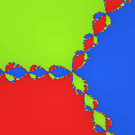
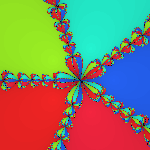
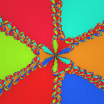

# 🌀 newton_fractal.jl

Newton fractals in **pure Julia** — zero packages, zero plotting libraries, zero mercy.

You give it one function `f(z)`, it gives you a 24-bit BMP image, hand-written byte by byte.
The only import is `Printf` — a stdlib — and honestly only for the jokes.

| `f(z) = z^3 - 1` | `f(z) = z^5 - 1` | `f(z) = z^6 + z^3 - 2` |
|:---:|:---:|:---:|
|  |  |  |

## Usage

1. Open `newton_fractal.jl` and edit exactly one line:

   ```julia
   f(z) = z^3 - 1        # the classic 🌀
   ```

2. Run it:

   ```console
   $ julia newton_fractal.jl
   🌀 Newton Fractal Generator — stdlibs only, we're hardcore like that
   🔮 Discovered 3 roots: 1.000+0.000i, -0.500+0.866i, -0.500-0.866i
   🎨 Painting 800×800 pixels of pure mathematical chaos...
      5% done — the fractal is fractalling
   💾 Wrote newton_fractal.bmp (1920054 bytes)
   ```

3. Open `newton_fractal.bmp` with any image viewer. 🎉

## What you get

- 🔮 **Automatic root discovery** — Newton finds his own roots on a sample grid, you never list them
- 🎨 **Basin coloring** — hue = *which* root a pixel fell into (golden-angle spacing), brightness = *how hard* Newton worked
- 🕳️ **The void** — pixels where Newton gave up are dark. The dark pixels mark the fractal boundary.
- 💾 **A hand-rolled BMP writer** — 14-byte file header, 40-byte BITMAPINFOHEADER, BGR pixels bottom-up, rows padded to multiples of 4. No image library survived contact with this script.

## Knobs

All settings live in section 2 of the script:

| Setting | Meaning | Default |
|---|---|---|
| `W, H` | image size in pixels | `800, 800` |
| `XC, YC` | center of the complex-plane view | `0.0, 0.0` |
| `SPAN` | half-width of the view | `2.4` |
| `MAXIT` | Newton iterations per pixel | `50` |
| `TOL` | "close enough to a root" 🤷 | `1e-8` |

## Functions worth trying

| `f(z)` | what happens |
|---|---|
| `z^3 - 1` | the classic — three basins 🌀 |
| `z^5 - 1` | flower power 🌸 |
| `z^6 + z^3 - 2` | six roots, go big or go home 🚀 |
| `z^4 + 2im*z^2 - 2` | spicy complex coefficients 🌶️ |
| `sin(z) - z` | Newton himself struggled here 🌊 |

⚠️ Transcendental functions have infinitely many roots — root discovery only finds
the ones near the view, and the boundary gets *very* fractal. That's a feature.

## How it works

1. Sample a 17×17 grid in the view, run Newton from each point, cluster the answers → the roots.
2. For every pixel, run Newton's method from its complex coordinate. `f` is analytic,
   so the derivative is just a tiny central difference — no symbolic math needed.
3. Color: hue = basin (root index × golden angle), value = `1 − 0.55·k/MAXIT`, so slow
   convergence shades toward dark and the boundary structure pops out.
4. Write the BMP, byte by byte, in ~40 lines of pure Base.

## FAQ

**Why BMP?** PNG needs zlib, SVG needs a browser, and we have neither shame nor dependencies.

**Why is it dark near basin boundaries?** Newton oscillates there like a caffeinated pendulum.

## License

[MIT](LICENSE) — do whatever, fractal responsibly.
